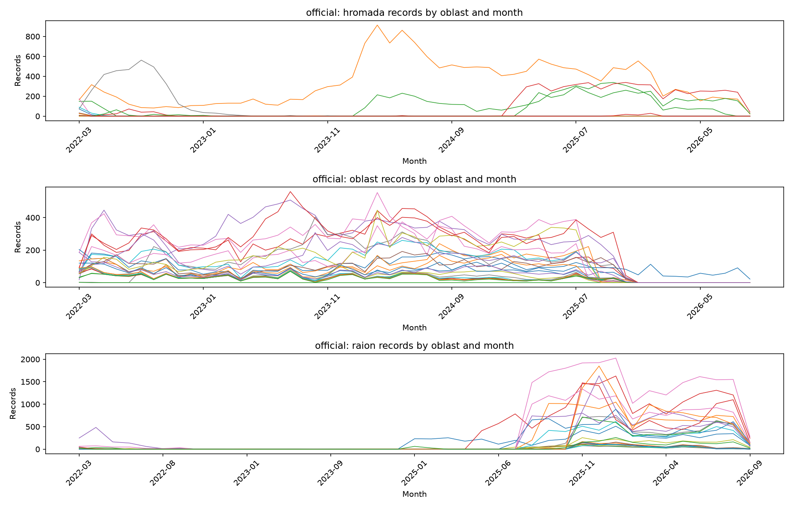
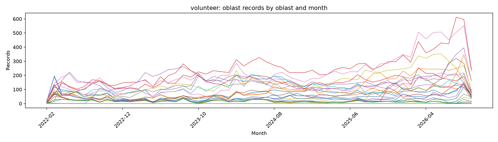

# Data audit

## Official candidate

- Source: `https://raw.githubusercontent.com/Vadimkin/ukrainian-air-raid-sirens-dataset/master/datasets/official_data_en.csv` (MIT-licensed repository dataset).
- Local file: `data\raw\official_data_en.csv`; downloaded this run: `False`.
- Retrieval/file time (UTC): 2026-10-12T17:51:13.929273367+00:00.
- First event (UTC): 2022-03-15T16:10:34+00:00.
- Last event (UTC): 2026-09-07T05:28:22+00:00.
- Source time zone: UTC; local-day attribution uses Europe/Kyiv.
- Timestamp precision observed: second.
- Alert levels present: hromada, oblast, raion.
- Parsed rows: 299,275; invalid starts: 0.

### Records by level, oblast, and month

### Reform date per unit
| unit | first detailed date |
| --- | --- |
| Cherkasy | 2022-03-16 |
| Chernihiv | 2022-03-22 |
| Chernivtsi | 2022-06-07 |
| Dnipro | 2022-03-16 |
| Donetsk | 2022-03-15 |
| Ivano-Frankivsk | 2025-11-06 |
| Kharkiv | 2022-03-16 |
| Kherson | 2022-03-28 |
| Khmelnytskyi | 2022-03-15 |
| Kropyvnytskyi | 2022-03-16 |
| Kyiv | not observed |
| Lutsk | 2025-11-06 |
| Lviv | 2025-09-03 |
| Mykolaiv | 2022-03-16 |
| Odesa | 2022-03-16 |
| Poltava | 2022-03-16 |
| Rivne | 2022-03-20 |
| Sumy | 2022-03-15 |
| Ternopil | 2025-11-06 |
| Uzhhorod | 2025-11-06 |
| Vinnytsia | 2022-06-09 |
| Zaporizhzhia | 2022-03-16 |
| Zhytomyr | 2022-03-15 |

### Imputed end times
| unit | year | records | imputed share |
| --- | --- | --- | --- |
| Cherkasy | 2022 | 1270 | 0.000 |
| Cherkasy | 2023 | 886 | 0.000 |
| Cherkasy | 2024 | 1786 | 0.000 |
| Cherkasy | 2025 | 1770 | 0.000 |
| Cherkasy | 2026 | 734 | 0.000 |
| Chernihiv | 2022 | 820 | 0.000 |
| Chernihiv | 2023 | 1008 | 0.000 |
| Chernihiv | 2024 | 1770 | 0.000 |
| Chernihiv | 2025 | 2320 | 0.000 |
| Chernihiv | 2026 | 1304 | 0.000 |
| Chernivtsi | 2022 | 414 | 0.000 |
| Chernivtsi | 2023 | 410 | 0.000 |
| Chernivtsi | 2024 | 446 | 0.000 |
| Chernivtsi | 2025 | 284 | 0.000 |
| Chernivtsi | 2026 | 87 | 0.000 |
| Dnipro | 2022 | 2276 | 0.000 |
| Dnipro | 2023 | 2862 | 0.001 |
| Dnipro | 2024 | 4074 | 0.000 |
| Dnipro | 2025 | 2800 | 0.000 |
| Dnipro | 2026 | 1520 | 0.000 |
| Donetsk | 2022 | 3308 | 0.001 |
| Donetsk | 2023 | 4634 | 0.000 |
| Donetsk | 2024 | 4026 | 0.000 |
| Donetsk | 2025 | 2872 | 0.000 |
| Donetsk | 2026 | 689 | 0.000 |
| Ivano-Frankivsk | 2022 | 462 | 0.000 |
| Ivano-Frankivsk | 2023 | 378 | 0.000 |
| Ivano-Frankivsk | 2024 | 426 | 0.005 |
| Ivano-Frankivsk | 2025 | 264 | 0.000 |
| Ivano-Frankivsk | 2026 | 83 | 0.000 |
| Kharkiv | 2022 | 3252 | 0.000 |
| Kharkiv | 2023 | 3312 | 0.000 |
| Kharkiv | 2024 | 4240 | 0.000 |
| Kharkiv | 2025 | 7360 | 0.000 |
| Kharkiv | 2026 | 4125 | 0.000 |
| Kherson | 2022 | 710 | 0.000 |
| Kherson | 2023 | 2376 | 0.001 |
| Kherson | 2024 | 2660 | 0.000 |
| Kherson | 2025 | 1774 | 0.000 |
| Kherson | 2026 | 1145 | 0.000 |
| Khmelnytskyi | 2022 | 556 | 0.000 |
| Khmelnytskyi | 2023 | 522 | 0.000 |
| Khmelnytskyi | 2024 | 710 | 0.000 |
| Khmelnytskyi | 2025 | 456 | 0.000 |
| Khmelnytskyi | 2026 | 149 | 0.000 |
| Kropyvnytskyi | 2022 | 1494 | 0.000 |
| Kropyvnytskyi | 2023 | 1380 | 0.000 |
| Kropyvnytskyi | 2024 | 2492 | 0.001 |
| Kropyvnytskyi | 2025 | 1834 | 0.000 |
| Kropyvnytskyi | 2026 | 918 | 0.001 |
| Kyiv | 2022 | 1010 | 0.000 |
| Kyiv | 2023 | 602 | 0.000 |
| Kyiv | 2024 | 1004 | 0.000 |
| Kyiv | 2025 | 1022 | 0.000 |
| Kyiv | 2026 | 503 | 0.000 |
| Lutsk | 2022 | 558 | 0.000 |
| Lutsk | 2023 | 392 | 0.000 |
| Lutsk | 2024 | 404 | 0.000 |
| Lutsk | 2025 | 288 | 0.014 |
| Lutsk | 2026 | 109 | 0.000 |
| Lviv | 2022 | 460 | 0.000 |
| Lviv | 2023 | 382 | 0.000 |
| Lviv | 2024 | 418 | 0.000 |
| Lviv | 2025 | 276 | 0.000 |
| Lviv | 2026 | 85 | 0.000 |
| Mykolaiv | 2022 | 1928 | 0.000 |
| Mykolaiv | 2023 | 1706 | 0.001 |
| Mykolaiv | 2024 | 2454 | 0.002 |
| Mykolaiv | 2025 | 1886 | 0.000 |
| Mykolaiv | 2026 | 1482 | 0.000 |
| Odesa | 2022 | 1114 | 0.000 |
| Odesa | 2023 | 888 | 0.000 |
| Odesa | 2024 | 1598 | 0.003 |
| Odesa | 2025 | 1708 | 0.000 |
| Odesa | 2026 | 1213 | 0.000 |
| Poltava | 2022 | 1554 | 0.001 |
| Poltava | 2023 | 1770 | 0.002 |
| Poltava | 2024 | 3220 | 0.000 |
| Poltava | 2025 | 2510 | 0.000 |
| Poltava | 2026 | 1292 | 0.000 |
| Rivne | 2022 | 554 | 0.004 |
| Rivne | 2023 | 428 | 0.000 |
| Rivne | 2024 | 534 | 0.000 |
| Rivne | 2025 | 364 | 0.000 |
| Rivne | 2026 | 158 | 0.000 |
| Sumy | 2022 | 1060 | 0.000 |
| Sumy | 2023 | 1856 | 0.000 |
| Sumy | 2024 | 3116 | 0.001 |
| Sumy | 2025 | 3708 | 0.001 |
| Sumy | 2026 | 1545 | 0.000 |
| Ternopil | 2022 | 524 | 0.000 |
| Ternopil | 2023 | 440 | 0.000 |
| Ternopil | 2024 | 464 | 0.000 |
| Ternopil | 2025 | 300 | 0.000 |
| Ternopil | 2026 | 104 | 0.000 |
| Uzhhorod | 2022 | 400 | 0.000 |
| Uzhhorod | 2023 | 362 | 0.000 |
| Uzhhorod | 2024 | 360 | 0.000 |
| Uzhhorod | 2025 | 250 | 0.000 |
| Uzhhorod | 2026 | 76 | 0.000 |
| Vinnytsia | 2022 | 830 | 0.000 |
| Vinnytsia | 2023 | 628 | 0.000 |
| Vinnytsia | 2024 | 924 | 0.000 |
| Vinnytsia | 2025 | 700 | 0.000 |
| Vinnytsia | 2026 | 260 | 0.000 |
| Zaporizhzhia | 2022 | 2448 | 0.000 |
| Zaporizhzhia | 2023 | 4040 | 0.000 |
| Zaporizhzhia | 2024 | 3916 | 0.000 |
| Zaporizhzhia | 2025 | 5822 | 0.000 |
| Zaporizhzhia | 2026 | 2646 | 0.000 |
| Zhytomyr | 2022 | 892 | 0.000 |
| Zhytomyr | 2023 | 554 | 0.000 |
| Zhytomyr | 2024 | 892 | 0.000 |
| Zhytomyr | 2025 | 762 | 0.000 |
| Zhytomyr | 2026 | 341 | 0.000 |

Detection: official data has no imputation flag, so no official end is labelled imputed. Volunteer rows are labelled imputed exactly when the source `naive` flag is true; repository documentation says these ends are set to start + 30 minutes. Exact 30-minute duration alone is not treated as proof when a source flag exists.

### Data-quality checks
| Check | Count |
| --- | ---: |
| Exact duplicate area/start/end rows | 113,911 |
| Missing ends | 0 |
| End at or before start | 4 |
| Overlapping records for the same area | 113,909 |

### Mapping coverage (23 units)
| unit | matching records | covered |
| --- | --- | --- |
| Cherkasy | 6446 | yes |
| Chernihiv | 7222 | yes |
| Chernivtsi | 1641 | yes |
| Dnipro | 13532 | yes |
| Donetsk | 15529 | yes |
| Ivano-Frankivsk | 1613 | yes |
| Kharkiv | 22289 | yes |
| Kherson | 8665 | yes |
| Khmelnytskyi | 2393 | yes |
| Kropyvnytskyi | 8118 | yes |
| Kyiv | 4141 | yes |
| Lutsk | 1751 | yes |
| Lviv | 1621 | yes |
| Mykolaiv | 9456 | yes |
| Odesa | 6521 | yes |
| Poltava | 10346 | yes |
| Rivne | 2038 | yes |
| Sumy | 11285 | yes |
| Ternopil | 1832 | yes |
| Uzhhorod | 1448 | yes |
| Vinnytsia | 3342 | yes |
| Zaporizhzhia | 18872 | yes |
| Zhytomyr | 3441 | yes |

### Unmapped source names (retained)
| source area | records |
| --- | --- |
| m. Nikopol ta Nikopolska terytorialna hromada | 11626 |
| Pokrovska terytorialna hromada | 4861 |
| Kyivska oblast | 3900 |
| m. Marhanets ta Marhanetska terytorialna hromada | 3230 |
| Chuhuivskyi raion | 3220 |
| Kupianskyi raion | 3113 |
| Bohodukhivskyi raion | 3102 |
| Iziumskyi raion | 3082 |
| Synelnykivskyi raion | 2732 |
| Konotopskyi raion | 2712 |
| Pavlohradskyi raion | 2652 |
| Lozivskyi raion | 2612 |
| Shostkynskyi raion | 2574 |
| Okhtyrskyi raion | 2478 |
| Nikopolskyi raion | 2264 |
| Kryvorizkyi raion | 2238 |
| Krasnohradskyi raion | 2219 |
| Koriukivskyi raion | 2122 |
| Nizhynskyi raion | 2074 |
| Myrhorodskyi raion | 2043 |
| Romenskyi raion | 1975 |
| Samarivskyi raion | 1974 |
| Chervonohryhorivska terytorialna hromada | 1964 |
| Polohivskyi raion | 1949 |
| Berdianskyi raion | 1931 |
| Novhorod-Siverskyi raion | 1929 |
| Vasylivskyi raion | 1929 |
| Melitopolskyi raion | 1927 |
| Kamianskyi raion | 1849 |
| Lubenskyi raion | 1804 |
| Kremenchutskyi raion | 1697 |
| Beryslavskyi raion | 1659 |
| Prylutskyi raion | 1552 |
| Zolotoniskyi raion | 1514 |
| Oleksandriiskyi raion | 1436 |
| Bashtanskyi raion | 1324 |
| Izmailskyi raion | 1311 |
| Bilhorod-Dnistrovskyi raion | 1309 |
| Bolhradskyi raion | 1306 |
| Kryvoozerska terytorialna hromada | 1282 |
| m. Voznesensk ta Voznesenska terytorialna hromada | 1258 |
| Bakhmutskyi raion | 1253 |
| Vyshhorodskyi raion | 1225 |
| Zvenyhorodskyi raion | 1221 |
| Brovarskyi raion | 1189 |
| Pokrovskyi raion | 1183 |
| Novoukrainskyi raion | 1128 |
| Umanskyi raion | 1127 |
| Boryspilskyi raion | 1085 |
| Holovanivskyi raion | 1061 |
| Volnovaskyi raion | 1039 |
| Mariupolskyi raion | 1003 |
| Kalmiuskyi raion | 1001 |
| Donetskyi raion | 999 |
| Horlivskyi raion | 999 |
| Voznesenskyi raion | 932 |
| Podilskyi raion | 931 |
| Berezivskyi raion | 930 |
| Rozdilnianskyi raion | 928 |
| m. Kryvyi Rih ta Kryvorizka terytorialna hromada | 914 |
| Obukhivskyi raion | 910 |
| Buchanskyi raion | 906 |
| Pervomaiskyi raion | 865 |
| Fastivskyi raion | 799 |
| Henicheskyi raion | 776 |
| Skadovskyi raion | 774 |
| Kakhovskyi raion | 774 |
| Bilotserkivskyi raion | 761 |
| Myrivska terytorialna hromada | 714 |
| Korostenskyi raion | 577 |
| Arbuzynska terytorialna hromada | 434 |
| Haisynskyi raion | 375 |
| Berdychivskyi raion | 354 |
| Khmilnytskyi raion | 342 |
| Zviahelskyi raion | 337 |
| Tulchynskyi raion | 332 |
| Zhmerynskyi raion | 322 |
| Mohyliv-Podilskyi raion | 308 |
| Shepetivskyi raion | 296 |
| Sarnenskyi raion | 278 |
| Kamianets-Podilskyi raion | 249 |
| Varaskyi raion | 232 |
| Dubenskyi raion | 190 |
| Dnistrovskyi raion | 162 |
| Kamin-Kashyrskyi raion | 153 |
| Chortkivskyi raion | 152 |
| Kremenetskyi raion | 150 |
| Kovelskyi raion | 145 |
| Vyzhnytskyi raion | 142 |
| Zolochivskyi raion | 132 |
| Stryiskyi raion | 130 |
| Chervonohradskyi raion | 130 |
| Kosivskyi raion | 128 |
| Verkhovynskyi raion | 126 |
| Yavorivskyi raion | 123 |
| Drohobytskyi raion | 123 |
| Orikhivska terytorialna hromada | 122 |
| Nadvirnianskyi raion | 122 |
| Tiachivskyi raion | 122 |
| Khustskyi raion | 122 |
| Sambirskyi raion | 121 |
| Kaluskyi raion | 121 |
| Volodymyr-Volynskyi raion | 120 |
| Berehivskyi raion | 120 |
| Mukachivskyi raion | 120 |
| Rakhivskyi raion | 119 |
| Kolomyiskyi raion | 118 |
| m. Yuzhnoukrainsk ta Yuzhnoukrainska terytorialna hromada | 66 |
| Bakhmutska terytorialna hromada | 54 |
| Velykonovosilkivska terytorialna hromada | 52 |
| Umanska terytorialna hromada | 48 |
| m. Vasylkiv ta Vasylkivska terytorialna hromada | 46 |
| m. Bila Tserkva ta Bilotserkivska terytorialna hromada | 40 |
| m. Lubny ta Lubenska terytorialna hromada | 38 |
| m. Pershotravensk ta Pershotravenska terytorialna hromada | 34 |
| m. Kremenchuk ta Kremenchutska terytorialna hromada | 32 |
| Toretska terytorialna hromada | 28 |
| Kurakhivska terytorialna hromada | 28 |
| Dobropilska terytorialna hromada | 28 |
| Avdiivska terytorialna hromada | 26 |
| Vuhledarska terytorialna hromada | 18 |
| m. Myrhorod ta Myrhorodska terytorialna hromada | 16 |
| Makarivska terytorialna hromada | 16 |
| m. Pervomaisk ta Pervomaiska terytorialna hromada | 12 |
| m. Boryspil ta Boryspilska terytorialna hromada | 12 |
| m. Brovary ta Brovarska terytorialna hromada | 12 |
| Myronivska terytorialna hromada | 10 |
| m. Fastiv ta Fastivska terytorialna hromada | 10 |
| Preobrazhenska terytorialna hromada | 10 |
| m. Pyriatyn ta Pyriatynska terytorialna hromada | 8 |
| m. Vatutine ta Vatutinska terytorialna hromada | 8 |
| m. Bashtanka ta Bashtanska terytorialna hromada | 8 |
| Zhashkivska terytorialna hromada | 6 |
| Uzynska terytorialna hromada | 6 |
| m. Obukhiv ta Obukhivska terytorialna hromada | 6 |
| Marinska terytorialna hromada | 6 |
| m. Chuhuiv ta Chuhuivska terytorialna hromada | 6 |
| Skvyrska terytorialna hromada | 4 |
| m. Shostka ta Shostkynska terytorialna hromada | 4 |
| m. Konotop ta Konotopska terytorialna hromada | 4 |
| m. Melitopol ta Melitopolska terytorialna hromada | 4 |
| Shyrokivska terytorialna hromada | 4 |
| m. Okhtyrka ta Okhtyrska terytorialna hromada | 4 |
| Borodianska terytorialna hromada | 4 |
| Prybuzhanivska terytorialna hromada | 4 |
| Oleksandrivska terytorialna hromada | 4 |
| Yelanetska terytorialna hromada | 4 |
| Vovchanska terytorialna hromada | 4 |
| Hrebinkivska terytorialna hromada | 2 |
| Vyshhorodska terytorialna hromada | 2 |
| m. Slavutych ta Slavutytska terytorialna hromada | 2 |
| Dubrovytska terytorialna hromada | 2 |
| m. Korosten ta Korostenska terytorialna hromada | 2 |
| m. Sarny ta Sarnenska terytorialna hromada | 2 |
| m. Mariupol ta Mariupolska terytorialna hromada | 2 |
| Ukrainska terytorialna hromada | 2 |
| m. Pereiaslav ta Pereiaslavska terytorialna hromada | 2 |
| Hostomelska terytorialna hromada | 2 |
| Luhanska oblast | 2 |
| Ocheretynska terytorialna hromada | 2 |
| Siverska terytorialna hromada | 2 |
| m. Izium ta Iziumska terytorialna hromada | 2 |
| Soledarska terytorialna hromada | 2 |
| m. Synelnykove ta Synelnykivska terytorialna hromada | 2 |
| m. Pavlohrad ta Pavlohradska terytorialna hromada | 2 |
| Bratska terytorialna hromada | 2 |
| Buzka terytorialna hromada | 2 |
| Veselynivska terytorialna hromada | 2 |
| Prybuzka terytorialna hromada | 2 |
| Bereznehuvatska terytorialna hromada | 2 |
| Novobuzka terytorialna hromada | 2 |
| Vradiivska terytorialna hromada | 2 |
| Kamianomostivska terytorialna hromada | 2 |
| Domanivska terytorialna hromada | 2 |
| Doroshivska terytorialna hromada | 2 |
| Mostivska terytorialna hromada | 2 |
| Novomarivska terytorialna hromada | 2 |
| Vilnozaporizka terytorialna hromada | 2 |
| Volodymyrivska terytorialna hromada | 2 |
| Horokhivska terytorialna hromada | 2 |
| Inhulska terytorialna hromada | 2 |
| Kazankivska terytorialna hromada | 2 |
| Pryvilnenska terytorialna hromada | 2 |
| m. Snihurivka ta Snihurivska terytorialna hromada | 2 |
| Sofiivska terytorialna hromada | 2 |
| Blahodatnenska terytorialna hromada | 2 |
| Myhiivska terytorialna hromada | 2 |
| Syniukhynobridska terytorialna hromada | 2 |
| Volnovaska terytorialna hromada | 2 |
| Kamianopotokivska terytorialna hromada | 2 |
| m. Pokrov ta Pokrovska terytorialna hromada | 2 |
| Zolochivska terytorialna hromada | 2 |
| Tsebrykivska terytorialna hromada | 2 |

### Units under alert most of the last 180 days
Screening proxy below is the share of dates with an alert start. Luhansk is deliberately not mapped; the repository documents its continuously active alert from 2022-04-04 and omits that permanent record from both CSV files, confirming the D-04 exclusion rather than treating absent rows as no alert.

| unit | start-date share |
| --- | --- |
| Cherkasy | 85.6% |
| Chernihiv | 96.1% |
| Dnipro | 96.7% |
| Donetsk | 92.2% |
| Kharkiv | 98.9% |
| Kherson | 91.1% |
| Kropyvnytskyi | 91.7% |
| Mykolaiv | 96.1% |
| Odesa | 93.9% |
| Poltava | 97.2% |
| Sumy | 98.3% |
| Zaporizhzhia | 98.3% |

## Volunteer candidate

- Source: `https://raw.githubusercontent.com/Vadimkin/ukrainian-air-raid-sirens-dataset/master/datasets/volunteer_data_en.csv` (MIT-licensed repository dataset).
- Local file: `data\raw\volunteer_data_en.csv`; downloaded this run: `False`.
- Retrieval/file time (UTC): 2026-10-12T18:06:36.193936586+00:00.
- First event (UTC): 2022-02-25T16:36:22+00:00.
- Last event (UTC): 2026-10-12T04:49:48+00:00.
- Source time zone: UTC; local-day attribution uses Europe/Kyiv.
- Timestamp precision observed: second.
- Alert levels present: oblast.
- Parsed rows: 116,174; invalid starts: 0.

### Records by level, oblast, and month

### Reform date per unit
| unit | first detailed date |
| --- | --- |
| Cherkasy | not applicable (oblast-only) |
| Chernihiv | not applicable (oblast-only) |
| Chernivtsi | not applicable (oblast-only) |
| Dnipro | not applicable (oblast-only) |
| Donetsk | not applicable (oblast-only) |
| Ivano-Frankivsk | not applicable (oblast-only) |
| Kharkiv | not applicable (oblast-only) |
| Kherson | not applicable (oblast-only) |
| Khmelnytskyi | not applicable (oblast-only) |
| Kropyvnytskyi | not applicable (oblast-only) |
| Kyiv | not applicable (oblast-only) |
| Lutsk | not applicable (oblast-only) |
| Lviv | not applicable (oblast-only) |
| Mykolaiv | not applicable (oblast-only) |
| Odesa | not applicable (oblast-only) |
| Poltava | not applicable (oblast-only) |
| Rivne | not applicable (oblast-only) |
| Sumy | not applicable (oblast-only) |
| Ternopil | not applicable (oblast-only) |
| Uzhhorod | not applicable (oblast-only) |
| Vinnytsia | not applicable (oblast-only) |
| Zaporizhzhia | not applicable (oblast-only) |
| Zhytomyr | not applicable (oblast-only) |

### Imputed end times
| unit | year | records | imputed share |
| --- | --- | --- | --- |
| Cherkasy | 2022 | 721 | 0.010 |
| Cherkasy | 2023 | 446 | 0.009 |
| Cherkasy | 2024 | 926 | 0.040 |
| Cherkasy | 2025 | 939 | 0.022 |
| Cherkasy | 2026 | 862 | 0.096 |
| Chernihiv | 2022 | 523 | 0.061 |
| Chernihiv | 2023 | 504 | 0.006 |
| Chernihiv | 2024 | 917 | 0.037 |
| Chernihiv | 2025 | 1548 | 0.023 |
| Chernihiv | 2026 | 2121 | 0.030 |
| Chernivtsi | 2022 | 219 | 0.014 |
| Chernivtsi | 2023 | 206 | 0.015 |
| Chernivtsi | 2024 | 227 | 0.013 |
| Chernivtsi | 2025 | 138 | 0.000 |
| Chernivtsi | 2026 | 127 | 0.016 |
| Dnipro | 2022 | 1314 | 0.018 |
| Dnipro | 2023 | 2127 | 0.067 |
| Dnipro | 2024 | 3130 | 0.039 |
| Dnipro | 2025 | 3057 | 0.023 |
| Dnipro | 2026 | 4124 | 0.004 |
| Donetsk | 2022 | 1294 | 0.009 |
| Donetsk | 2023 | 2418 | 0.040 |
| Donetsk | 2024 | 2077 | 0.037 |
| Donetsk | 2025 | 1637 | 0.126 |
| Donetsk | 2026 | 1123 | 0.337 |
| Ivano-Frankivsk | 2022 | 259 | 0.012 |
| Ivano-Frankivsk | 2023 | 189 | 0.016 |
| Ivano-Frankivsk | 2024 | 219 | 0.023 |
| Ivano-Frankivsk | 2025 | 142 | 0.063 |
| Ivano-Frankivsk | 2026 | 86 | 0.093 |
| Kharkiv | 2022 | 1529 | 0.034 |
| Kharkiv | 2023 | 1906 | 0.135 |
| Kharkiv | 2024 | 2325 | 0.094 |
| Kharkiv | 2025 | 2852 | 0.042 |
| Kharkiv | 2026 | 4389 | 0.003 |
| Kherson | 2022 | 355 | 0.020 |
| Kherson | 2023 | 1391 | 0.148 |
| Kherson | 2024 | 1578 | 0.160 |
| Kherson | 2025 | 1434 | 0.273 |
| Kherson | 2026 | 1676 | 0.122 |
| Khmelnytskyi | 2022 | 294 | 0.020 |
| Khmelnytskyi | 2023 | 262 | 0.000 |
| Khmelnytskyi | 2024 | 359 | 0.014 |
| Khmelnytskyi | 2025 | 235 | 0.009 |
| Khmelnytskyi | 2026 | 216 | 0.148 |
| Kropyvnytskyi | 2022 | 825 | 0.008 |
| Kropyvnytskyi | 2023 | 1064 | 0.010 |
| Kropyvnytskyi | 2024 | 1960 | 0.020 |
| Kropyvnytskyi | 2025 | 1245 | 0.023 |
| Kropyvnytskyi | 2026 | 1245 | 0.028 |
| Kyiv | 2022 | 615 | 0.028 |
| Kyiv | 2023 | 304 | 0.010 |
| Kyiv | 2024 | 524 | 0.044 |
| Kyiv | 2025 | 539 | 0.056 |
| Kyiv | 2026 | 691 | 0.207 |
| Lutsk | 2022 | 328 | 0.006 |
| Lutsk | 2023 | 196 | 0.010 |
| Lutsk | 2024 | 209 | 0.014 |
| Lutsk | 2025 | 453 | 0.042 |
| Lutsk | 2026 | 1019 | 0.048 |
| Lviv | 2022 | 277 | 0.022 |
| Lviv | 2023 | 190 | 0.000 |
| Lviv | 2024 | 220 | 0.050 |
| Lviv | 2025 | 340 | 0.035 |
| Lviv | 2026 | 771 | 0.009 |
| Mykolaiv | 2022 | 981 | 0.012 |
| Mykolaiv | 2023 | 1449 | 0.012 |
| Mykolaiv | 2024 | 1762 | 0.106 |
| Mykolaiv | 2025 | 1416 | 0.170 |
| Mykolaiv | 2026 | 2291 | 0.045 |
| Odesa | 2022 | 590 | 0.010 |
| Odesa | 2023 | 441 | 0.007 |
| Odesa | 2024 | 823 | 0.012 |
| Odesa | 2025 | 888 | 0.015 |
| Odesa | 2026 | 1855 | 0.029 |
| Poltava | 2022 | 860 | 0.002 |
| Poltava | 2023 | 886 | 0.006 |
| Poltava | 2024 | 1644 | 0.025 |
| Poltava | 2025 | 1425 | 0.026 |
| Poltava | 2026 | 1754 | 0.023 |
| Rivne | 2022 | 318 | 0.013 |
| Rivne | 2023 | 214 | 0.005 |
| Rivne | 2024 | 268 | 0.007 |
| Rivne | 2025 | 194 | 0.021 |
| Rivne | 2026 | 292 | 0.106 |
| Sumy | 2022 | 638 | 0.121 |
| Sumy | 2023 | 1306 | 0.289 |
| Sumy | 2024 | 1796 | 0.138 |
| Sumy | 2025 | 2227 | 0.027 |
| Sumy | 2026 | 2777 | 0.009 |
| Ternopil | 2022 | 291 | 0.000 |
| Ternopil | 2023 | 219 | 0.000 |
| Ternopil | 2024 | 238 | 0.004 |
| Ternopil | 2025 | 156 | 0.019 |
| Ternopil | 2026 | 111 | 0.153 |
| Uzhhorod | 2022 | 203 | 0.000 |
| Uzhhorod | 2023 | 180 | 0.006 |
| Uzhhorod | 2024 | 187 | 0.021 |
| Uzhhorod | 2025 | 126 | 0.008 |
| Uzhhorod | 2026 | 65 | 0.046 |
| Vinnytsia | 2022 | 512 | 0.002 |
| Vinnytsia | 2023 | 314 | 0.003 |
| Vinnytsia | 2024 | 477 | 0.031 |
| Vinnytsia | 2025 | 370 | 0.024 |
| Vinnytsia | 2026 | 420 | 0.055 |
| Zaporizhzhia | 2022 | 1245 | 0.007 |
| Zaporizhzhia | 2023 | 2024 | 0.005 |
| Zaporizhzhia | 2024 | 1968 | 0.013 |
| Zaporizhzhia | 2025 | 1950 | 0.040 |
| Zaporizhzhia | 2026 | 1786 | 0.057 |
| Zhytomyr | 2022 | 540 | 0.011 |
| Zhytomyr | 2023 | 280 | 0.011 |
| Zhytomyr | 2024 | 458 | 0.031 |
| Zhytomyr | 2025 | 417 | 0.029 |
| Zhytomyr | 2026 | 632 | 0.073 |

Detection: official data has no imputation flag, so no official end is labelled imputed. Volunteer rows are labelled imputed exactly when the source `naive` flag is true; repository documentation says these ends are set to start + 30 minutes. Exact 30-minute duration alone is not treated as proof when a source flag exists.

### Data-quality checks
| Check | Count |
| --- | ---: |
| Exact duplicate area/start/end rows | 0 |
| Missing ends | 0 |
| End at or before start | 6 |
| Overlapping records for the same area | 0 |

### Mapping coverage (23 units)
| unit | matching records | covered |
| --- | --- | --- |
| Cherkasy | 3894 | yes |
| Chernihiv | 5613 | yes |
| Chernivtsi | 917 | yes |
| Dnipro | 13752 | yes |
| Donetsk | 8549 | yes |
| Ivano-Frankivsk | 895 | yes |
| Kharkiv | 13001 | yes |
| Kherson | 6434 | yes |
| Khmelnytskyi | 1366 | yes |
| Kropyvnytskyi | 6339 | yes |
| Kyiv | 2673 | yes |
| Lutsk | 2205 | yes |
| Lviv | 1798 | yes |
| Mykolaiv | 7899 | yes |
| Odesa | 4597 | yes |
| Poltava | 6569 | yes |
| Rivne | 1286 | yes |
| Sumy | 8744 | yes |
| Ternopil | 1015 | yes |
| Uzhhorod | 761 | yes |
| Vinnytsia | 2093 | yes |
| Zaporizhzhia | 8973 | yes |
| Zhytomyr | 2327 | yes |

### Unmapped source names (retained)
| source area | records |
| --- | --- |
| Kyivska oblast | 4471 |
| Luhanska oblast | 3 |

### Units under alert most of the last 180 days
Screening proxy below is the share of dates with an alert start. Luhansk is deliberately not mapped; the repository documents its continuously active alert from 2022-04-04 and omits that permanent record from both CSV files, confirming the D-04 exclusion rather than treating absent rows as no alert.

| unit | start-date share |
| --- | --- |
| Cherkasy | 90.6% |
| Chernihiv | 100.0% |
| Dnipro | 100.6% |
| Donetsk | 98.3% |
| Kharkiv | 100.6% |
| Kherson | 99.4% |
| Kropyvnytskyi | 97.2% |
| Kyiv | 89.4% |
| Lutsk | 95.0% |
| Lviv | 87.8% |
| Mykolaiv | 100.0% |
| Odesa | 98.9% |
| Poltava | 99.4% |
| Sumy | 100.0% |
| Zaporizhzhia | 100.6% |

## Candidate agreement

The sources remain separate. For complete overlapping calendar months (2022-04-01 through 2026-08-31), each unit's intervals were clipped to Europe/Kyiv local days, overlapping intervals were unioned, and daily alert minutes were compared. Zero-alert days are included.

| unit | daily-minute correlation | mean absolute difference (minutes) |
| --- | --- | --- |
| Cherkasy | 0.731 | 58.7 |
| Chernihiv | 0.675 | 138.0 |
| Chernivtsi | 0.431 | 14.0 |
| Dnipro | 0.125 | 151.6 |
| Donetsk | 0.268 | 321.2 |
| Ivano-Frankivsk | 0.918 | 4.6 |
| Kharkiv | 0.333 | 555.9 |
| Kherson | 0.793 | 58.4 |
| Khmelnytskyi | 0.478 | 22.8 |
| Kropyvnytskyi | 0.679 | 68.0 |
| Kyiv | 0.780 | 27.4 |
| Lutsk | 0.300 | 52.3 |
| Lviv | 0.385 | 26.5 |
| Mykolaiv | 0.757 | 61.7 |
| Odesa | 0.791 | 35.4 |
| Poltava | 0.703 | 109.8 |
| Rivne | 0.884 | 8.6 |
| Sumy | 0.628 | 318.9 |
| Ternopil | 0.438 | 13.5 |
| Uzhhorod | 0.480 | 7.7 |
| Vinnytsia | 0.872 | 16.0 |
| Zaporizhzhia | 0.375 | 191.6 |
| Zhytomyr | 0.659 | 35.6 |

## Proposed wording for decisions

### D-01 Source file and imputed end times — Proposed
Use the official dataset as the primary source because it represents official reporting and supplies capital-raion/hromada detail required by SPEC §2. Retain the volunteer dataset only as an audited comparison candidate: it starts earlier and supplies an explicit `naive` imputation flag, but is oblast-only. Do not merge the sources. Report official-versus-volunteer agreement using the per-unit daily-minute correlations and mean absolute differences above. For volunteer data, flag `naive=True` ends; the official source provides no imputation flag, so do not infer imputation merely from an exact 30-minute duration.

### D-02 Units and capital mapping — Proposed
Use exactly the 23 configured units. Kyiv combines Kyiv City and Kyiv oblast operationally but uses only Kyiv City records; Donetsk uses Kramatorsk; Luhansk is excluded, and Crimea and Sevastopol are not mapped.

### D-03 Episode merge tolerance — Proposed
Use 60 seconds. Both candidates have second-level timestamp precision, so this absorbs only sub-minute reporting gaps.

### D-04 Luhansk oblast — Proposed
Keep Luhansk excluded. The repository identifies a continuously active Luhansk alert beginning 2022-04-04 and intentionally omits permanent alerts from both datasets.

### D-05 Reporting reform dates — Proposed
Use the official candidate's per-unit first capital-raion/hromada dates. The volunteer candidate is oblast-only and cannot identify the reporting reform.
