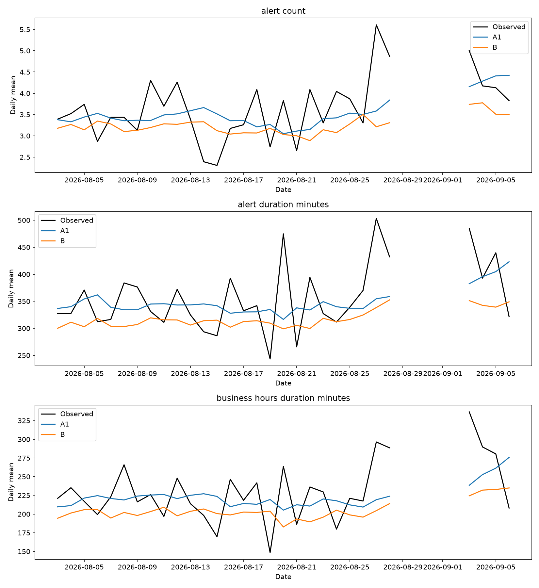
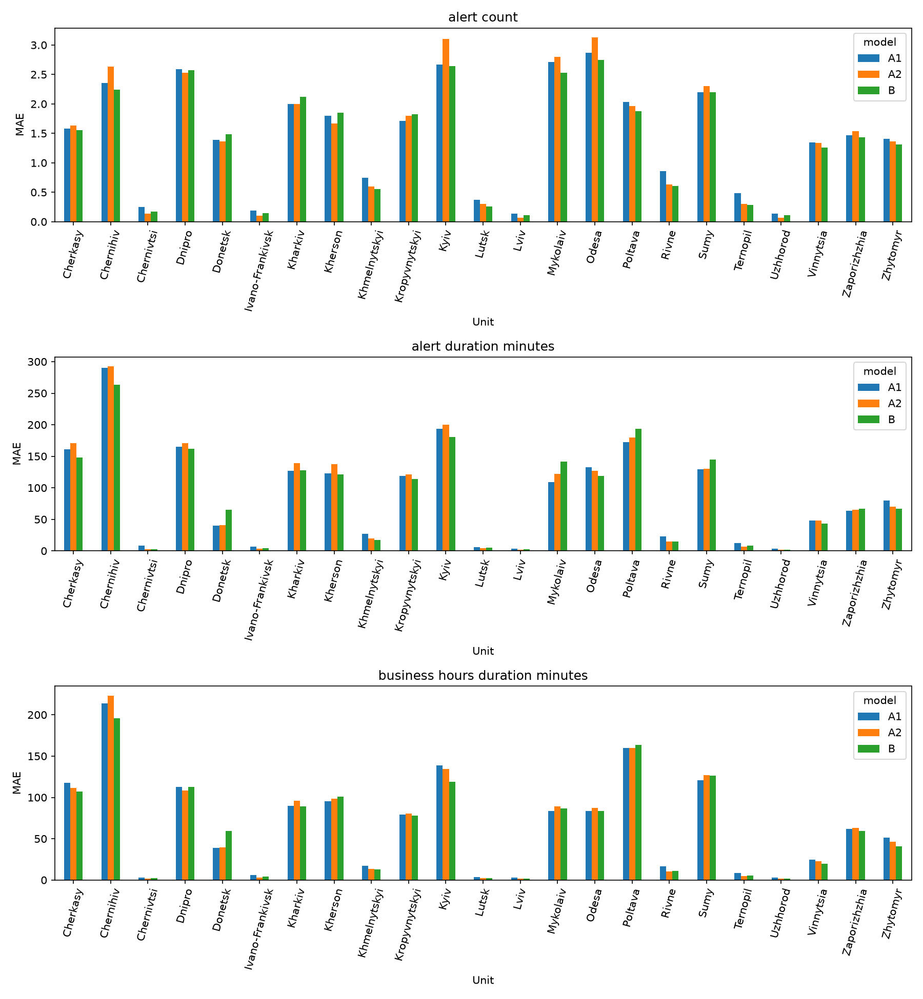
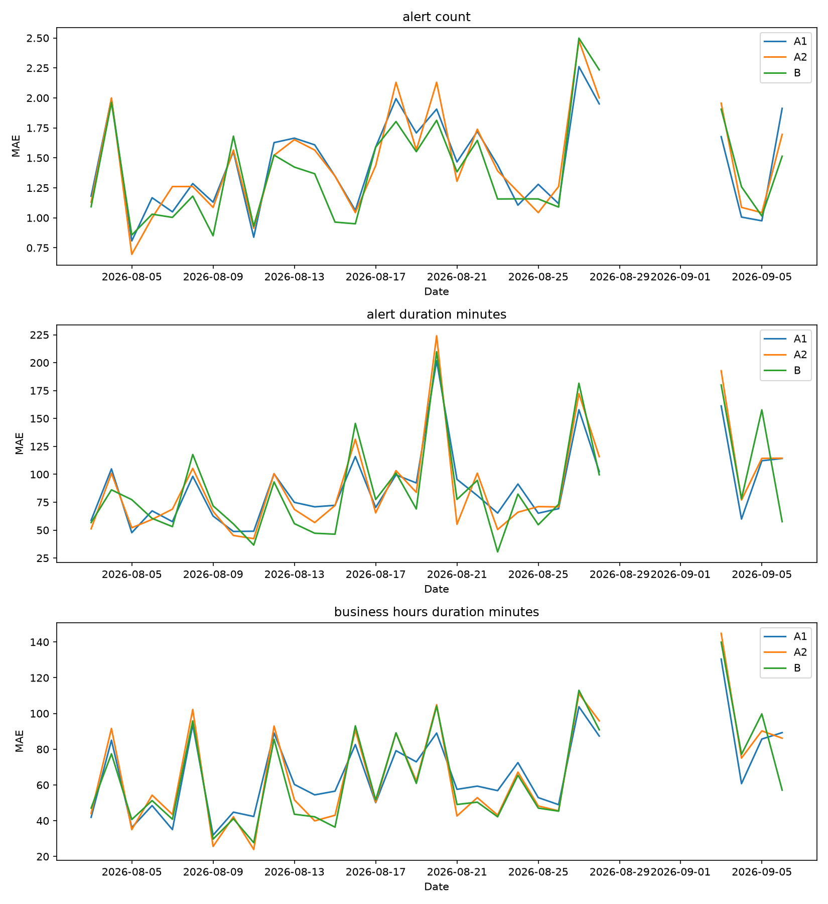

# Evaluation

## Data and windows

- Source: [https://raw.githubusercontent.com/Vadimkin/ukrainian-air-raid-sirens-dataset/master/datasets/official_data_en.csv](https://raw.githubusercontent.com/Vadimkin/ukrainian-air-raid-sirens-dataset/master/datasets/official_data_en.csv)
- Data snapshot (last event timestamp): `2026-09-07T05:28:22+00:00`
- Source gap: `2022-10-29T22:56:11+00:00` to `2022-10-30T13:10:34+00:00` (14.24 hours); all overlapping local dates are excluded.
- Source gap: `2022-11-20T07:18:31+00:00` to `2022-11-20T19:37:38+00:00` (12.32 hours); all overlapping local dates are excluded.
- Source gap: `2022-11-25T20:12:36+00:00` to `2022-11-26T09:36:31+00:00` (13.40 hours); all overlapping local dates are excluded.
- Source gap: `2022-11-27T22:16:09+00:00` to `2022-11-28T11:54:56+00:00` (13.65 hours); all overlapping local dates are excluded.
- Source gap: `2022-12-25T16:01:01+00:00` to `2022-12-26T09:02:28+00:00` (17.02 hours); all overlapping local dates are excluded.
- Source gap: `2023-01-02T20:28:54+00:00` to `2023-01-03T10:27:27+00:00` (13.98 hours); all overlapping local dates are excluded.
- Source gap: `2023-01-12T19:42:10+00:00` to `2023-01-13T08:21:05+00:00` (12.65 hours); all overlapping local dates are excluded.
- Source gap: `2023-01-14T16:36:44+00:00` to `2023-01-15T06:39:59+00:00` (14.05 hours); all overlapping local dates are excluded.
- Source gap: `2023-01-17T06:02:26+00:00` to `2023-01-17T19:13:39+00:00` (13.19 hours); all overlapping local dates are excluded.
- Source gap: `2023-01-17T19:13:39+00:00` to `2023-01-18T11:52:01+00:00` (16.64 hours); all overlapping local dates are excluded.
- Source gap: `2023-03-18T17:46:22+00:00` to `2023-03-19T07:25:28+00:00` (13.65 hours); all overlapping local dates are excluded.
- Source gap: `2025-04-19T18:52:32+00:00` to `2025-04-20T13:56:24+00:00` (19.06 hours); all overlapping local dates are excluded.
- Source gap: `2026-08-29T04:55:28+00:00` to `2026-09-02T13:48:04+00:00` (104.88 hours); all overlapping local dates are excluded.
- Validation: 2026-06-04 through 2026-08-02 (60 dates)
- Test: 2026-08-03 through 2026-09-06 (30 complete dates)

## Metrics

MAE, share of test days with lower MAE than A1, and the 90% day-bootstrap interval
for MAE difference versus A1 are shown below. Negative differences favor the model.

| group | target | model | mae | share_days_lower_than_a1 | mae_difference_vs_a1_ci90_low | mae_difference_vs_a1_ci90_high |
| --- | --- | --- | --- | --- | --- | --- |
| overall | alert_count | A1 | 1.448 | 0.000 | 0.000 | 0.000 |
| overall | alert_count | A2 | 1.451 | 0.533 | -0.037 | 0.042 |
| overall | alert_count | B | 1.386 | 0.700 | -0.113 | -0.003 |
| overall | alert_duration_minutes | A1 | 88.9 | 0.000 | 0.0 | 0.0 |
| overall | alert_duration_minutes | A2 | 90.0 | 0.433 | -3.7 | 5.3 |
| overall | alert_duration_minutes | B | 87.6 | 0.533 | -7.8 | 5.0 |
| overall | business_hours_duration_minutes | A1 | 66.6 | 0.000 | 0.0 | 0.0 |
| overall | business_hours_duration_minutes | A2 | 66.3 | 0.500 | -3.4 | 2.6 |
| overall | business_hours_duration_minutes | B | 64.5 | 0.533 | -5.6 | 1.2 |
| frontline | alert_count | A1 | 1.764 | 0.000 | 0.000 | 0.000 |
| frontline | alert_count | A2 | 1.800 | 0.533 | -0.060 | 0.150 |
| frontline | alert_count | B | 1.809 | 0.500 | -0.043 | 0.139 |
| frontline | alert_duration_minutes | A1 | 90.1 | 0.000 | 0.0 | 0.0 |
| frontline | alert_duration_minutes | A2 | 93.9 | 0.400 | -0.9 | 7.7 |
| frontline | alert_duration_minutes | B | 101.1 | 0.300 | 4.7 | 16.7 |
| frontline | business_hours_duration_minutes | A1 | 77.9 | 0.000 | 0.0 | 0.0 |
| frontline | business_hours_duration_minutes | A2 | 81.4 | 0.367 | -1.0 | 8.4 |
| frontline | business_hours_duration_minutes | B | 83.4 | 0.333 | 0.7 | 10.2 |
| other | alert_count | A1 | 1.381 | 0.000 | 0.000 | 0.000 |
| other | alert_count | A2 | 1.377 | 0.433 | -0.051 | 0.043 |
| other | alert_count | B | 1.297 | 0.733 | -0.143 | -0.026 |
| other | alert_duration_minutes | A1 | 88.7 | 0.000 | 0.0 | 0.0 |
| other | alert_duration_minutes | A2 | 89.2 | 0.533 | -4.5 | 5.6 |
| other | alert_duration_minutes | B | 84.8 | 0.567 | -11.6 | 3.9 |
| other | business_hours_duration_minutes | A1 | 64.3 | 0.000 | 0.0 | 0.0 |
| other | business_hours_duration_minutes | A2 | 63.2 | 0.567 | -4.3 | 2.2 |
| other | business_hours_duration_minutes | B | 60.5 | 0.567 | -7.9 | 0.1 |

## Charts

## Verdicts

Verdicts are stated only when the 90% interval excludes zero.

- overall, alert_count, B: better than A1.
- frontline, alert_duration_minutes, B: worse than A1.
- frontline, business_hours_duration_minutes, B: worse than A1.
- other, alert_count, B: better than A1.

## Limitations

- The official source ends at the snapshot above and has not been updated beyond it.
- The data contain only one reporting-reform period, in autumn 2025, limiting evidence about reform effects.
- The Kyiv unit uses Kyiv City records as an approximation for both Kyiv City and Kyiv oblast.
- Luhansk, Crimea, and Sevastopol are excluded; Luhansk's near-permanent alert would distort pooled metrics.
- Kherson dates before 2022-11-11 are excluded because occupation-era zeros do not represent quiet days.
- Exactly-30-minute records are retained as possible imputed ends and may bias duration labels.
